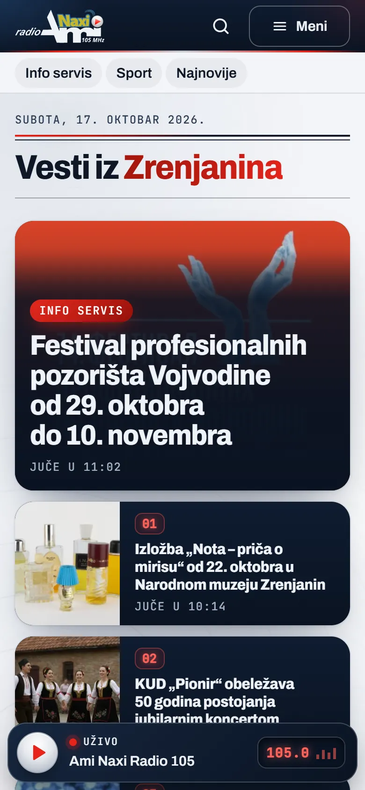

# Ami Naxi Radio 105

Portal radija iz Zrenjanina na istoj platformi kao Radio AMI, sa sopstvenim izgledom, 1.000 prenetih vesti i plejerom sa ekranom 105.0.

**[aminaxiradio.rs](https://aminaxiradio.rs/)** · [Studija slučaja](https://svilenkovic.rs/radovi/ami-naxi-radio) · [English](README.md)

> [!NOTE]
> Klijentski projekat. Izvorni kod pripada klijentu i čuva se u privatnom repozitorijumu. Ova stranica opisuje šta sam uradio i kako.

<table>
  <tr><td><b>Klijent</b></td><td>Medijski centar Klik 105 doo Zrenjanin</td></tr>
  <tr><td><b>Delatnost</b></td><td>Lokalni radio i portal vesti</td></tr>
  <tr><td><b>Lokacija</b></td><td>Zrenjanin</td></tr>
  <tr><td><b>Vrsta</b></td><td>Portal radija sa panelom za redakciju (PWA)</td></tr>
  <tr><td><b>Moj deo posla</b></td><td>Redizajn, izrada, selidba, hosting i održavanje</td></tr>
  <tr><td><b>Tehnologije</b></td><td>PHP 8.3, MariaDB, Redis, nginx, PWA</td></tr>
</table>

## O projektu

Ami Naxi Radio 105 emituje program na 105 MHz i objavljuje vesti iz Zrenjanina. Umesto drugog sajta od nule, radi na platformi koju sam napravio za Radio AMI iz Kikinde. Kod je jedan, a svaki radio ima profil sa imenom, frekvencijom, bojama, rubrikama i adresama strima, pa se ispravka ili nova mogućnost napravi jednom i stiže na oba portala.

Dva portala ne smeju da izgledaju kao kopije, pa je ovaj dobio svoj izgled, koji sam nazvao Srebrni signal. Osnova je hladna i svetla, tamni delovi su teget, a crvena je preuzeta sa play dugmeta iz loga; uz levu ivicu ide skala radija kao linija vodilja, a plejer u zaglavlju ima mali ekran sa frekvencijom 105.0. Preneo sam 1.000 vesti sa slikama, svaku sliku u AVIF i WebP varijantama, a 344 stare adrese vode na nove.

## Šta sam uradio

- 1.000 vesti prenetih sa slikama, svaka slika u AVIF i WebP varijantama u više širina, i 344 preusmerenja starih adresa
- Jedan kod zajedno sa Radiom AMI, uz profil sajta za ime, boje, rubrike, strim i podatke za impresum
- Izgled Srebrni signal: skala radija kao linija vodilja, plejer sa ekranom 105.0 i mozaik vesti na naslovnoj
- Kontakt forma preko mog centralnog servisa za forme, sa HTML mejlom redakciji i potvrdom pošiljaocu
- Poseban panel za redakciju koji se instalira kao zasebna aplikacija, javni deo kao aplikacija i reklame sa statistikom, uz partnere prenete sa starog sajta
- Medijana LCP na mobilnom Lighthouse merenju od 1,6 do 1,8 s, CLS 0 i bez axe prekršaja; mobilni PageSpeed 99, 17. oktobra 2026.

## Merenja

| | Performanse | Pristupačnost | Dobre prakse | SEO |
| :-- | :-: | :-: | :-: | :-: |
| Telefon | 99 | 100 | 100 | 100 |
| Desktop | 100 | 100 | 100 | 100 |

PageSpeed Insights, laboratorijsko merenje živog sajta, oktobar 2026. Sigurnosna zaglavlja: 6 od 6. axe provera pristupačnosti: bez prekršaja. Strukturisani podaci: `BroadcastService`, `NewsMediaOrganization`, `RadioStation`.

## Snimci ekrana

<table>
  <tr>
    <td width="68%" valign="top"></td>
    <td width="32%" valign="top"></td>
  </tr>
</table>

Info servis, sa reklamom i plejerom uživo u bočnoj koloni

Strana vesti sa uvodom, autorom, datumom i vremenom čitanja

---

Izrada: [D. Svilenković](https://svilenkovic.rs).
